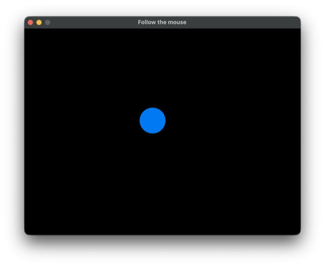

# Drawing with RocRay

This example uses the [RocRay](https://github.com/lukewilliamboswell/roc-ray) platform to draw an interactive circle. Moving the mouse moves the circle, and holding the left mouse button changes its color, showing how a small graphical app keeps state, responds to input, and draws each frame.

```roc
file:main.roc:snippet:example
```

The three callbacks divide up the work: `init!` creates the initial model, `update!` records the mouse position and button state, and `render!` draws the circle from that model. The platform handles the window and closes it when you press Escape.

RocRay releases are paired with particular Roc versions. This app header selects a specific RocRay version and its supported nightly together:

```roc
file:main.roc:snippet:header
```

## Output



The circle is blue when the mouse button is released and turns red while the left button is held.

From this directory, build with `roc build main.roc`, then run `./main` (`main.exe` on Windows). The release bundle already includes the compiled host, so you do not need Zig to build the app.

The default bundle supports Windows x64, macOS (both Intel and Apple Silicon), and Linux x64 (using X11 or XWayland).

For an unattended smoke test, you can run `./main --host-headless --host-headless-frames=3`. This runs a few cycles without opening a window, which is useful for checking that the app executes successfully. Checking its appearance still requires running it with rendering enabled.
